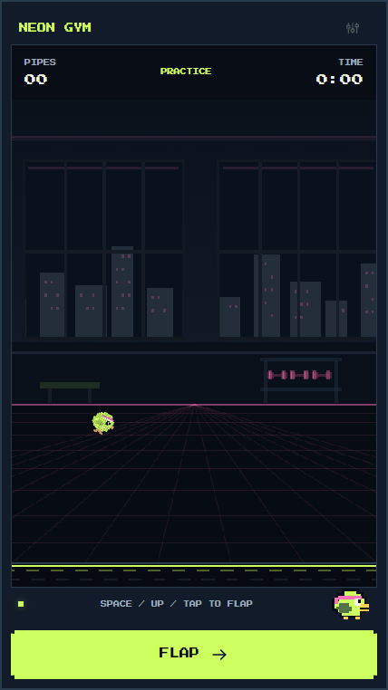

# Drop & Flap

Your reps. Their wings. An original, private pushup-controlled pixel arcade built with React, TypeScript, Vite, HTML canvas, and MediaPipe.

## Run locally

Use Node.js 22.12+ (tested here with 24.19).

1. `npm install --cache .npm-cache`
2. `npm run assets`
3. `npm run dev`
4. Open http://127.0.0.1:5173

Assets are included in this checkout. The asset command restores the pinned official pose model and matches the installed MediaPipe WASM version. It downloads only public model/license files; camera frames are never sent by that script or the app. The supplied model is checksum-verified. First offline installation currently caches roughly 28 MB including browser runtime variants; subsequent launches use cached files.

For a production preview: `npm run build`, then `npm run preview` at http://127.0.0.1:4173. Production is installable and works offline after the service worker finishes caching. Development mode does not register a service worker.

When an installed version finds an update, **Update app** appears outside camera setup and workouts. Select it to reload into the new version. Updates never automatically reload an ongoing set. Versions before 1.1.1 do not have this button: close every app tab/window and reopen the app after its new version has downloaded.

## Play

**Camera set:** prop your phone upright on a stable surface on the floor, facing you. Allow the front camera, keep your face and both shoulders visible, and use adequate light. Select **I'm in position**. Hold your top position for 3 seconds, lower slowly and hold for 4 seconds, then return to the top during the final 3-second countdown. The app captures your range and maps your nose position to the bird. A complete top-bottom-top cycle counts one rep. If tracking disappears for 0.5 seconds, gameplay pauses. Resume or end the set with the visible controls. Stop if the movement is uncomfortable; the app is a game, not a form assessment.

**Practice:** select **Try keyboard / tap practice**. Use Space, Up arrow, touch the game, or the Flap button. Escape pauses. Practice counts pipes only and is excluded from workout rep totals.

**Settings:** all 12 plan themes, five background modes, five pixel scenes, adjustable blur/dim/CRT, difficulty, sounds, haptics, high contrast, and reduced motion. Defaults are Neon Gym, pixel scene, and Easy. Photos persist only in this browser. Live camera backgrounds are shown during camera sets; practice has a solid backdrop for those modes.

**History and sharing:** camera totals and personal bests are separate from practice. Results auto-save locally. Save Image generates an original PNG card; Share uses the native file share sheet where supported and otherwise downloads the card. Camera images are excluded from result cards.

**Install:** Android Chrome's Install app option; on iPhone, Share → Add to Home Screen. Camera use needs HTTPS or localhost. Accessing a phone through an unencrypted LAN address will not enable its camera. The GitHub Pages deployment supplies HTTPS for phone camera access.

## Privacy and storage

No account, analytics, backend, video upload, or frame persistence. Model, fonts, and WASM load from the app's own origin. Settings use localStorage. Workout totals and an optional user-selected photo use IndexedDB. Browser clearing removes these. Share sends a generated totals card only when requested. Wake Lock and haptics are optional browser capabilities.

## Verification

- `npm run check`: lint, strict TypeScript, production build, 78 deterministic unit tests.
- `npm run test:e2e`: production browser workflow tests.
- `npm run test:form`: actual form-screen counting/history tests using synthetic joint fixtures.
- `node scripts/capture.mjs`: desktop/mobile visual captures and request-origin inventory.

For browser tests, install a browser using `node node_modules/@playwright/test/cli.js install chromium`, or set `PLAYWRIGHT_CHROMIUM_EXECUTABLE_PATH` to a locally installed Chrome. `PLAYWRIGHT_BASE_URL` can select an already-running production preview. Scripts call Node entrypoints directly because this Windows project's directory name contains an ampersand.

Pose tests use deterministic landmark fixtures and mocked lifecycle failures. They do **not** establish real pushup accuracy. No sample human exercise videos were supplied. Safari on a physical iPhone, Chrome on a physical Android phone, form variants, poor light, and interference from another person or a pet remain release validation work. See [validation evidence](docs/VALIDATION.md) and [form-check definitions](docs/FORM_CHECKS.md).

## Structure

- `src/game`: UI-independent game engine, rep state machine, and original canvas renderer.
- `src/pose`: replaceable `PoseSource` interface and local MediaPipe adapter.
- `src/themes`: twelve data-driven palettes, characters, scene defaults, and sound frequencies.
- `src/ui` and `src/lib`: React screens, device storage, generated audio, sharing.
- `public`: local model/WASM, licenses, and original PWA icons.
- `tests`: browser checks. Add permissioned human recordings later; never commit personal video by accident.

## GitHub Pages and CI

The included workflow runs lint/typecheck/unit tests/browser tests and prepares a Pages artifact on pushes to main. It deploys after checks pass. Set the repository's Pages source to **GitHub Actions**. `VITE_BASE_PATH` is automatically set to the repository subdirectory; model, service-worker, font, and icon paths follow it. The phone-test deployment targets https://vineeth-pydi.github.io/drop-and-flap/. Physical-phone validation is still required; this is a test release, and the app does not assess correct pushup technique.

This implementation is the V1 scope. Accounts, prizes, leaderboards, other exercises, daily goals/streaks, and native app wrappers remain later versions.

## License

Original application code and art: MIT. MediaPipe model/runtime: Apache 2.0. Press Start 2P and VT323: SIL Open Font License 1.1. See [third-party notices](THIRD_PARTY_NOTICES.md).

## Form-check mode

The FORM tab adds experimental side-view checks, separate from the face-controlled arcade. Place the phone to the side, choose standard or knee pushups, and select **Start camera**. Tap **Start form set** while you can reach the phone: an **8-second preparation countdown** gives you time to move into position. The set starts after the countdown and checks posture while running; you do not have to be detected before tapping Start. Start each rep with extended arms, your body aligned, and your whole near-side arm and body visible.

The counter requires a complete bend-and-extend cycle and body alignment within the checks. Missing or uncertain landmarks and unfinished movements earn no rep. If tracking disappears, the set stays running and waits for you to reappear; return to the extended-arm position to start a fresh movement without touching the phone. **Pause** is manual; **Resume form set** also gives you an 8-second preparation countdown. Switching away from the browser pauses the set. Completed form sets are labeled separately in History. The form geometry thresholds are unchanged in version 1.1.1.

This is geometric feedback from estimated 2D joints, not a certification of safe or correct technique. It cannot measure chest-to-floor clearance, force, pain, muscle activation, or all forms of elbow flare from one side camera. Real human/video accuracy still needs validation. The general body-line and elbow-extension concepts are consistent with [NASM's pushup exercise description](https://www.nasm.org/resource-center/exercise-library/push-up); numerical thresholds are this app's experimental engineering settings. MediaPipe supplies the estimated landmarks described in [Google's Pose Landmarker guide](https://developers.google.com/edge/mediapipe/solutions/vision/pose_landmarker).
